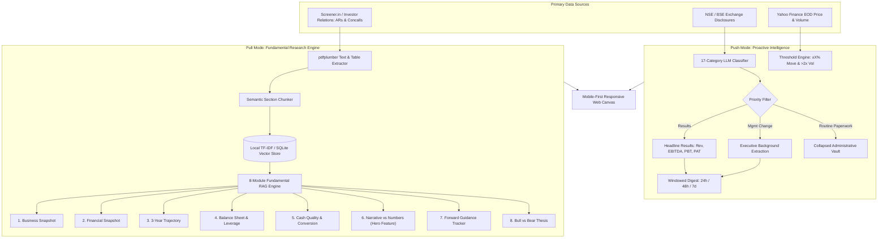

# FINN — Financial Investment Agent
> **AI-Powered Intelligence Layer for Public Markets Value Investors**  
> Developed for the **ENAM Holdings AI Engineer Build Challenge (Screening 2027)**  
> Deliverable: Mobile-First Prototype + Primary Grounded Intelligence Engine

---

## 1. Philosophy & Challenge Context

ENAM Holdings is an iconic fundamental value investment firm known for high-conviction, bottom-up public-markets investing. In public equities, investors are drowned in noise — macro commentary, broker notes, endless routine filings, and intraday volatility.

**FINN** is built on three foundational principles:
1. **Primary Source Grounding:** Signal lives in primary documents — exchange filings, audited annual reports, and concall transcripts. Broker commentary and news are noisy and consensus-driven.
2. **Filtering > Aggregating:** The scarce skill is judgment — surfacing the few material developments that actually move the needle, and burying compliance paperwork beautifully.
3. **Smart Compute Economics:** Efficient model routing that achieves institutional-grade synthesis while minimizing API token spend.

---

## 2. Architecture Overview



---

## 3. The Two Interaction Modes

### Mode A: Push (Proactive Intelligence)
* **Windowed Digest (24h / 48h / 7d):** Filters filings across the 20-stock portfolio. Routine compliance paperwork is collapsed into an accordion, while material events are highlighted.
* **Results Headline Extractor:** Instantly converts quarterly results announcements into standardized tables showing **Revenue, Operating EBITDA, PBT, and PAT** along with QoQ and YoY delta percentages in Crores (₹ Cr).
* **Management Change Bio:** Extracts the executive's role, action (joining/resigning), and professional pedigree.
* **Threshold-Triggered Alerts:** Evaluates daily price changes and volume spikes against user-configurable sliders (e.g. $\ge \pm 5\%$ move or $\ge 2.0\times$ 20-day average volume).

### Mode B: Pull (Primary Grounded Research)
* **Narrative vs. Numbers (Showcase Feature):** Compares management forward guidance given in earnings calls over the last 4 quarters against subsequent actual delivered results. Outputs an objective credibility score, delivery accuracy %, and hit/miss cards.
* **Cash Quality & Conversion:** Analyzes whether accounting profits convert into real cash ($\text{CFO} / \text{PAT} > 85\%$), tracking Free Cash Flow and capex intensity.
* **Any-Ticker Generalizer:** Dynamically researches unseeded NSE tickers on the fly by scraping, parsing, and caching disclosures.

---

## 4. Quickstart: Running FINN Locally

### Prerequisites
* Python 3.10+ (Standard Python installation)
* Web browser (Chrome / Safari / Firefox)

### Setup & Launch (One Single Command)
```bash
# Clone the repository
git clone https://github.com/Aayush-Jhawar/Enam.git
cd Enam

# (Optional) Install dependencies if running on a fresh environment
pip install -r requirements.txt

# Launch the unified server (starts REST API + Mobile Web App)
python run.py
```

### Accessing the Prototype
* **Live Deployed Prototype:** [https://finn-enam-1tdf.onrender.com/](https://finn-enam-1tdf.onrender.com/)
* **Mobile-First Web App (Local):** Open [http://127.0.0.1:8000/](http://127.0.0.1:8000/)
* **Interactive API Documentation:** Open [http://127.0.0.1:8000/docs](http://127.0.0.1:8000/docs) (or on live site: [/docs](https://finn-enam-1tdf.onrender.com/docs))

*(Note: The web app includes a built-in "Toggle Full Screen / Mobile Frame" button in the header so you can preview the mobile experience directly on desktop or on a smartphone over local WiFi).*

---

## 5. Smart Model Routing & Compute Frugality

FINN implements model routing to optimize compute expenditure:

| Task Type | Assigned Model | Cost per 1M Tokens | Rationale |
| :--- | :--- | :--- | :--- |
| **Announcement Classification** | Gemini 1.5 Flash / Rule Heuristics | $\$0.075$ | High volume, structured 17-class classification |
| **Headline Results Extraction** | Gemini 1.5 Flash / JSON Mode | $\$0.075$ | Deterministic numeric extraction |
| **Management Bio Extraction** | Gemini 1.5 Flash | $\$0.075$ | Simple text summarization |
| **Narrative vs. Numbers** | GPT-4o / Claude 3.5 Sonnet | $\$2.50$ | Deep multi-quarter synthesis & credibility audit |
| **Bull vs. Bear Synthesis** | GPT-4o / Claude 3.5 Sonnet | $\$2.50$ | Dialectical critical reasoning |

Every LLM call logs its exact token usage to the `llm_call_log` table in SQLite, providing a live real-time dollar audit accessible at `/api/audit/costs` or directly in the UI.

---

## 6. Project Structure

```
├── backend/
│   ├── config.py                 # System constants, model costs, 17 announcement categories
│   ├── database.py               # SQLAlchemy SQLite models & schema
│   ├── seed_data.py              # Data bootstrapper with authentic filings & EOD prices
│   ├── test_engine.py            # Automated audit verification script
│   ├── main.py                   # FastAPI REST API server
│   └── services/
│       ├── alert_engine.py       # Threshold triggers for price swings & volume anomalies
│       ├── announcement_classifier.py # 17-category classification & bio/results enrichment
│       ├── announcement_fetcher.py    # NSE API & RSS corporate filing fetcher
│       ├── digest_engine.py      # Prioritized windowed digest generator
│       ├── fundamentals_fetcher.py    # Screener.in document scraper & pdfplumber extractor
│       ├── model_router.py       # Tiered model routing & token expenditure tracker
│       ├── price_fetcher.py      # EOD prices & 20-day rolling volume signals
│       ├── research_engine.py    # 8 fundamental research modules & Any-Ticker pipeline
│       └── vector_store.py       # Zero-dependency local TF-IDF / Cosine Similarity store
├── frontend/
│   ├── index.html                # Mobile-first responsive web canvas
│   ├── app.js                    # UI state management, API clients, and module renderers
│   └── style.css                 # Editorial dark theme with amber accents & JetBrains Mono
├── requirements.txt              # Production Python dependencies
├── run.py                        # Unified one-click application launcher
├── COVERING_NOTE.md              # Official submission writeup for assessment@enam.com
└── README.md                     # Institutional project documentation
```

---

## 7. Mock Portfolio Watchlist (20 NSE Stocks)

FINN tracks a diversified 20-stock portfolio across multiple sectors:
`RELIANCE`, `TCS`, `HDFCBANK`, `BAJFINANCE`, `ZOMATO`, `TATAMOTORS`, `ADANIPORTS`, `SUNPHARMA`, `TITAN`, `COALINDIA`, `INFY`, `MARUTI`, `ITC`, `ONGC`, `DIVISLAB`, `PIDILITIND`, `ASIANPAINT`, `ASTRAL`, `WIPRO`, `LTIM`.

Plus 5 ad-hoc tickers for on-demand pull testing:
`JIOFIN`, `NYKAA`, `PAYTM`, `IRFC`, `POLYCAB`.
*(Any unlisted ticker can also be dynamically researched via the search bar).*

